Proofable stops every agent action you never allowed before it runs, and lets the next agent or system check finished work instead of paying to redo it. Each result below comes from the live service, compared with the setup teams use today, and links to a record you can check or a test you can rerun.

## Results

| Your outcome | With Proofable | Compared with |
|---|---|---|
| [Agent governance coverage](#governance-coverage) | **48 of 48** scenarios | 46 for the best gateway, 43 for Claude Code or Codex with a gateway, 13 for coding agents on their own |
| [Actions outside an agent's permission](#agents-only-do-what-you-allowed) | **Stopped before they run**, 8 of 8 live tests | Every allowed action still ran; reviewers verified the records independently |
| [Private data a hijacked agent sends out](#a-hijacked-agent-cannot-send-your-data-out) | **0 of 6** attempts got out | 6 of 6 got out on an all-purpose key |
| [Forged or altered records](#records-nobody-can-fake) | **150 of 150** caught | A format-only check accepted all 150 |
| [Work handed to another agent](#handoffs-between-agents) | **$0.024** per correct outcome, 3 of 3 tampered handoffs caught | $0.078 to redo the work; trusting the forwarded text caught 0 of 3 |
| [Reusing finished work](#reuse-instead-of-redo) | **3.7 ms, 0 tokens** | 2.79 s and 2,426 tokens to redo it, 750× slower |
| [Agent memory that knows which rule is current](#memory-that-knows-what-is-current) | **42× fewer tokens**, 8.8× faster | 4,462,980 tokens and 493 s searching every record body |
| [Worst-case research spend](#research-with-a-cost-ceiling) | **16,301 tokens** | 50,554 on the open web, 3.1× higher, at about twice the cost per answer |
| [One identity check reused by 100 apps](#identity-checks-paid-for-once) | **$1.75** | $150.00 re-running Stripe Identity in each, 85× more |

## Where it covers you

| Layer | How teams do it today | What breaks in production | What Proofable does instead |
|---|---|---|---|
| **Agent governance & tool gates** | Local tool prompts in Claude Code, Cursor or Codex, or a stateless API/MCP proxy gateway | Local prompts have no owner, cross-agent rules or spend cap. A stateless gateway only sees the request in flight: it cannot verify an owner-signed delegation for that specific agent or emit a signed receipt another system can verify without trusting the gateway's database | Checks an owner-signed chain of permission (owner to agent identity to scoped permission with spend cap, expiry and instant revoke) before the tool executes, and emits a signed receipt after |
| **Multi-agent handoffs & state** | Unstructured RAG memory (Mem0, Zep, vector chunks) and raw JSON/markdown passed between agents (LangGraph, CrewAI) | Unstructured chunks carry no active/revoked status or signer authority, so agents read full historical documents to guess which rule is current. Forwarded text carries no proof of what the upstream agent actually read or produced | Stores typed, revocable, owner-signed state (`rules`, `instruction`, `receipts`) and passes a signed receipt between agents |
| **Portable verification** | Point-to-point identity, wallet or domain checks (Stripe Identity, Sumsub, OAuth) trapped inside one app's database | Every downstream app, partner or agent forces the user through the vendor check again and pays the vendor fee again | Wraps the verified result (ZKPassport, Webacy, DNS, OAuth) in a portable CAIP-380 proof so downstream apps and agents check eligibility without re-running the vendor flow |

## What it stops

### Governance coverage

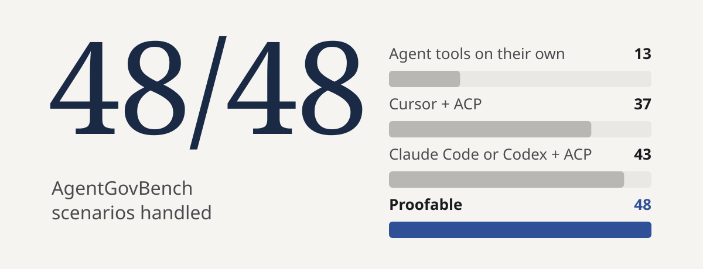
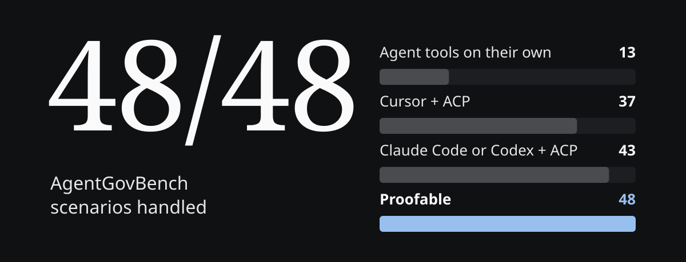
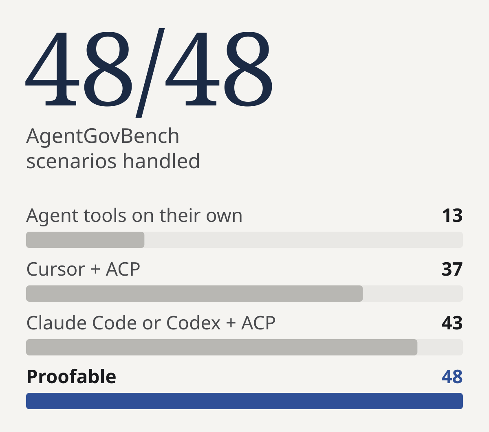
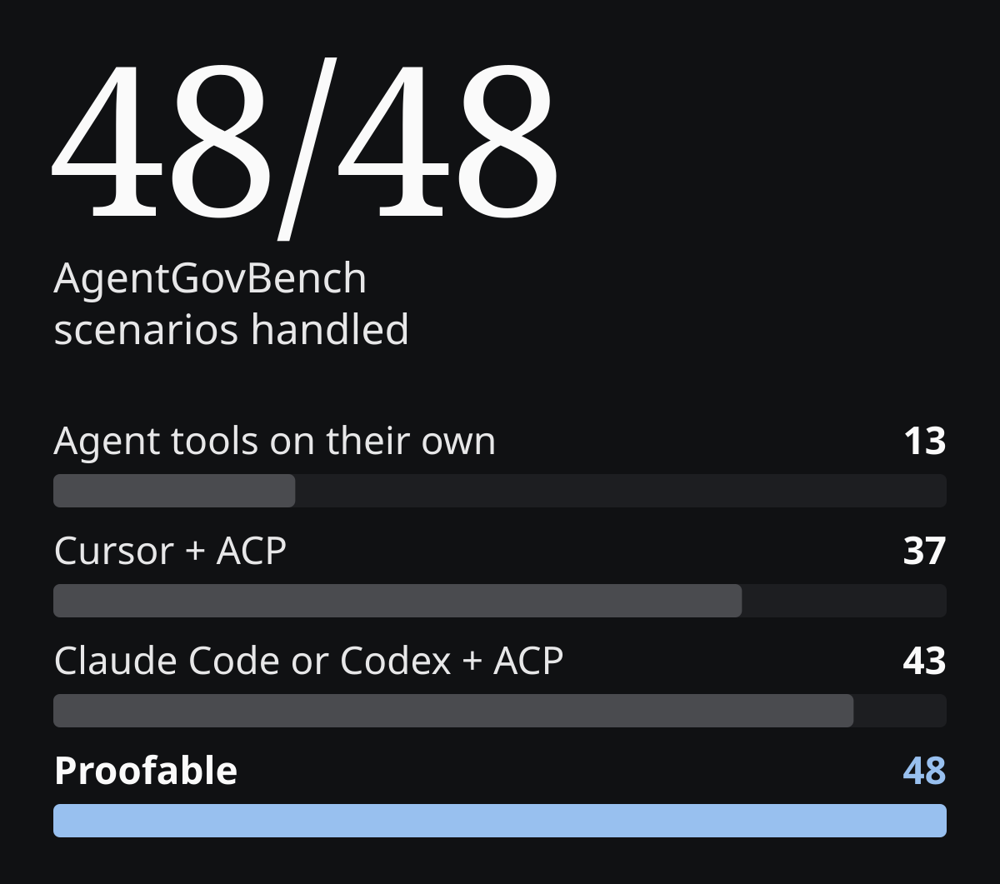

[AgentGovBench](https://github.com/agentic-control-plane/agentgovbench) is the open library of 48 agent-governance scenarios in eight areas: audit completeness, cross-tenant isolation, delegation provenance, fail-mode discipline, identity propagation, per-user policy, rate limits and scope inheritance. Each scenario is tagged with the NIST AI RMF controls it tests, and nothing passes on a technicality.

| Setup | Scenarios handled |
|---|---|
| Proofable policy engine | **48 of 48** |
| ACP, the maintainers' gateway ([published run](https://github.com/agentic-control-plane/agentgovbench/actions/runs/37759892335)) | 46 of 48 |
| A gate that allows everything | 20 of 48 |
| No governance | 5 of 48 |

Against the agent tools teams already use, from the maintainers' [published results](https://github.com/agentic-control-plane/agentgovbench/tree/main/results), where Proofable also handles 48 of 48:

| Setup | Scenarios handled |
|---|---|
| Proofable policy engine | **48 of 48** |
| Anthropic Agent SDK with the ACP gateway | 46 of 48 |
| OpenAI Agents SDK with the ACP gateway | 45 of 48 |
| Claude Code or Codex CLI with ACP hooks | 43 of 48 |
| CrewAI or LangGraph with the ACP gateway | 40 of 48 |
| Cursor with ACP over MCP | 37 of 48 |
| Claude Code, Codex CLI, Cursor, the OpenAI or Anthropic agent SDK, CrewAI or LangGraph on its own | 13 of 48 |

**Why coding agents on their own handle 13, the best gateway handles 46, and Proofable handles 48:**

- **Coding agents on their own (13):** Claude Code, Codex CLI and Cursor only have local tool-permission prompts (`allow/deny` bash or file access). They have no owner-bound agent identity, no cross-agent delegation, no spend caps, no external policy engine and no signed audit trail.
- **A stateless API/MCP gateway (46):** a proxy in front of tool calls enforces rate limits, role-based access, tool allowlists and server logs.
- **The two checks a stateless gateway cannot pass (48):** a proxy only sees the request in flight. It cannot verify (1) an **owner-signed, revocable delegation** binding the person to that specific agent, task scope, spend cap and expiry, such as holding a sub-agent to a narrower scope than its parent, or (2) a **signed execution receipt** (`qHash`) binding input, policy state and output, so the next agent or an outside reviewer can verify what ran offline without trusting the gateway's database.

**See where your own agent stands.** Paste your agent's repository and one run scores it on the same 48 scenarios beside Proofable, scans the repository and its MCP surface, and probes your MCP endpoint when the repository names one: [run the audit on your agent](https://proofable.me/verify?gateId=gate_25cfeb508d484170a2ce).

### Agents only do what you allowed

**8 of 8 permission tests pass on the live service.** Every action outside the agent's permission is stopped before it runs, and every action it is allowed to take runs. Each row opens its signed record.

| Test | What happened |
|---|---|
| [Permission granted](https://proofable.me/proof/0x64f293e61b826e03bd1de6564fc2db8cec0f50390bafc8bdf162ec9961262fca) | Ran and completed |
| [Action outside the permission](https://proofable.me/proof/0xffdc0455b72732a8c6a31eb4e2861943b85dbc271fe2dfa8b18d0e85d2b33726) | Stopped before it ran |
| [Needs approval, approved](https://proofable.me/proof/0xe662eaa54a5e3d7875827794d6a69b4e86973fee49cfa71e555f821d5ed28c35) | Held until approved, then ran |
| [Needs approval, nobody answers](https://proofable.me/proof/0x6c53cb0005c9dc30fde5bb1bd06860d74ae51790be3869a6605bfc9f71e01954) | Never ran; a late approval was refused |
| [Permission revoked](https://proofable.me/proof/0x8a3e5ff89c8a86423bae61db96c9732f319a6f6cdb34f4bde560c90d25366c95) | Stopped; no job created |
| [Permission expired](https://proofable.me/proof/0xf1880cba0876acc2364e31892b261a47299c0a70177b61b32d465fcd1b61447a) | Stopped; no job created |
| [Revoked permission reused](https://proofable.me/proof/0x1d987781eb519337fa9e62043831ee187340f6e589f217b16b99ed98be5acfbc) | Stopped every time |
| [Revoked mid-job](https://github.com/proofable/docs/tree/main/public/evidence/aaif/authority-at-dispatch/2026-11-02-suite) | The running job stopped with its reason 18 seconds after the permission was revoked, and the next one was refused |

Reviewers in the AgenTrust integrations project [verified the records offline](https://github.com/agentrust-io/integrations/issues/333#issuecomment-6414048198) on their own machines: every checksum matched and every signature verified. Its maintainers then [chose them](https://github.com/agentrust-io/integrations/issues/333#issuecomment-6436264551) as the dispatch evidence for their authority comparison. Rerun all eight on your own account with [Run the chain](/run-the-chain#run-it-end-to-end).

### A hijacked agent cannot send your data out

**When an agent was taken over, a scoped permission refused 6 of 6 attempts to send private data out, before they ran; an all-purpose key let all 6 through.** The scoped agent still finished every task and never used a tool it did not need; under the all-purpose key, 14 of 36 runs did. Measured across 84 live runs, five published attack templates and two models, with a signed record for each run. [Run the test on your own agent](https://github.com/proofable/mcp/tree/main/examples/injection-test).

### Records nobody can fake

**150 of 150 forged records caught.** Each of 15 real records was changed ten ways, such as editing the content, swapping the owner or flipping one bit of the signature. Every changed copy failed offline signature verification and every real record passed. A check that only reads the format accepted all 150.

```sh
git clone --depth 1 https://github.com/proofable/docs
cd docs/public/evidence/checks
npm install
node tamper-check.mjs
```

## What it saves

### Reuse instead of redo

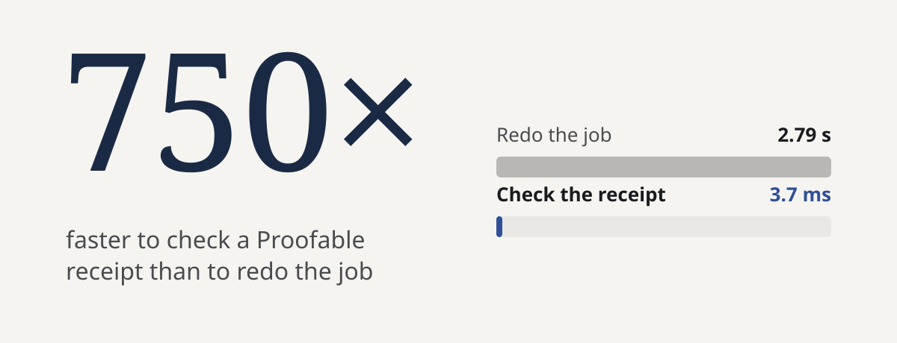
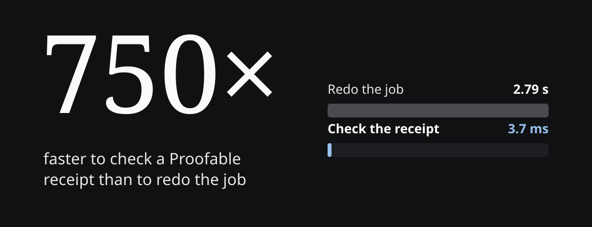
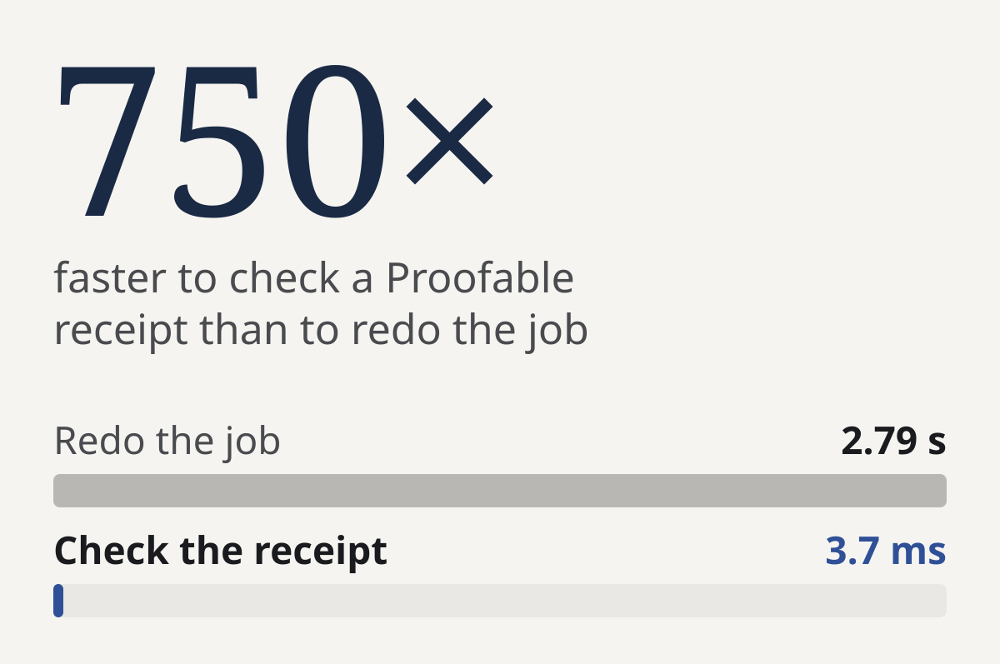
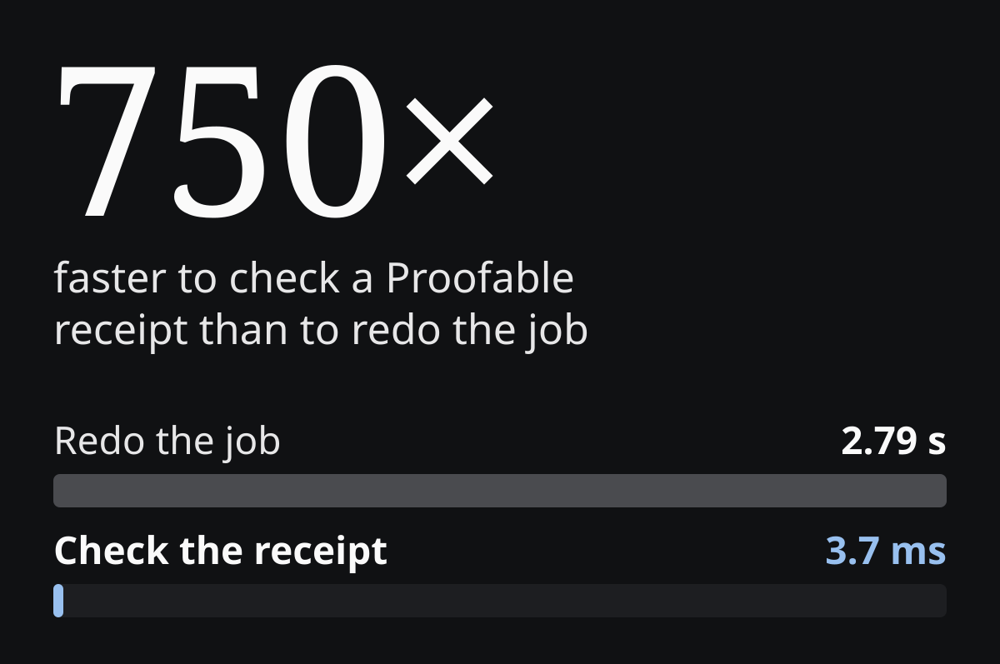

Redoing a finished agent job took 2.79 s and 2,426 AI tokens. Checking its signed receipt took 3.7 ms and no tokens: 750× faster, which is 1 hour instead of 32 days at a million checks. [Time it yourself](#run-it-yourself).

### Handoffs between agents

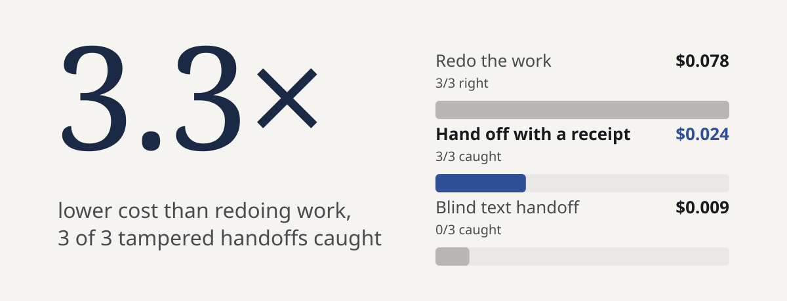
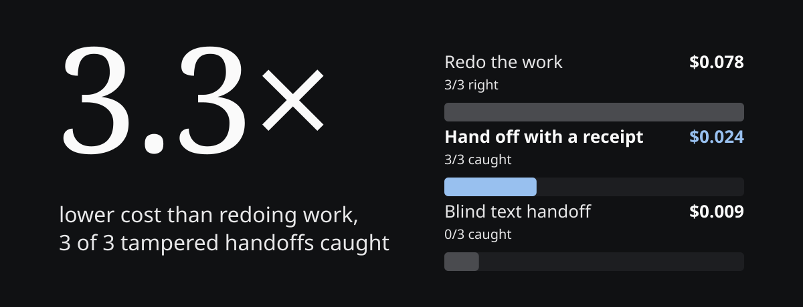
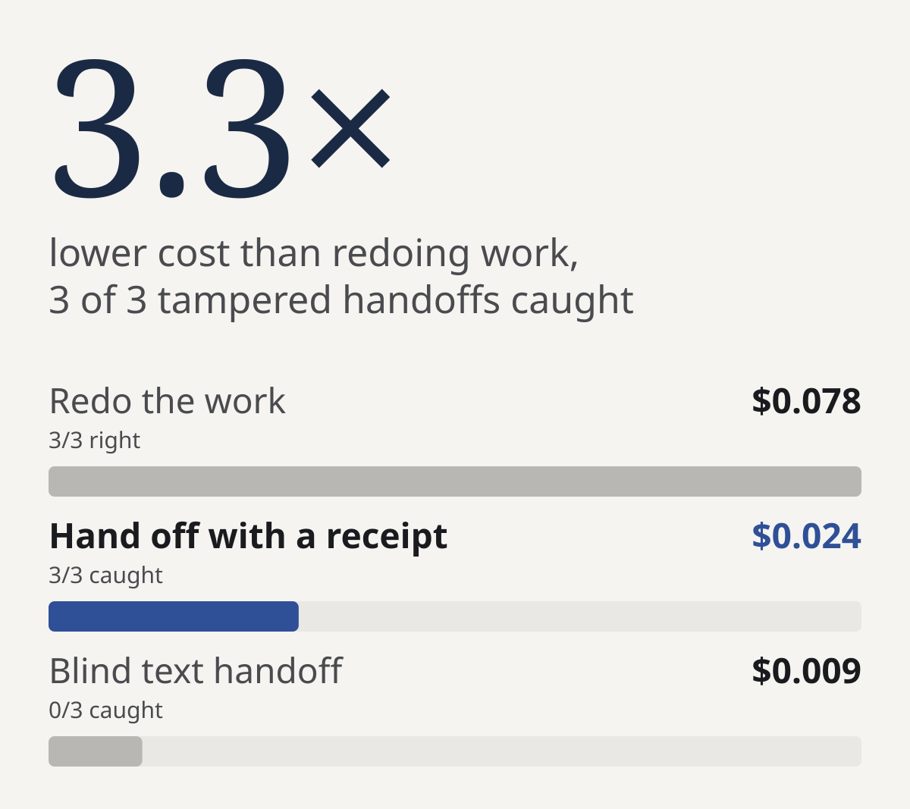
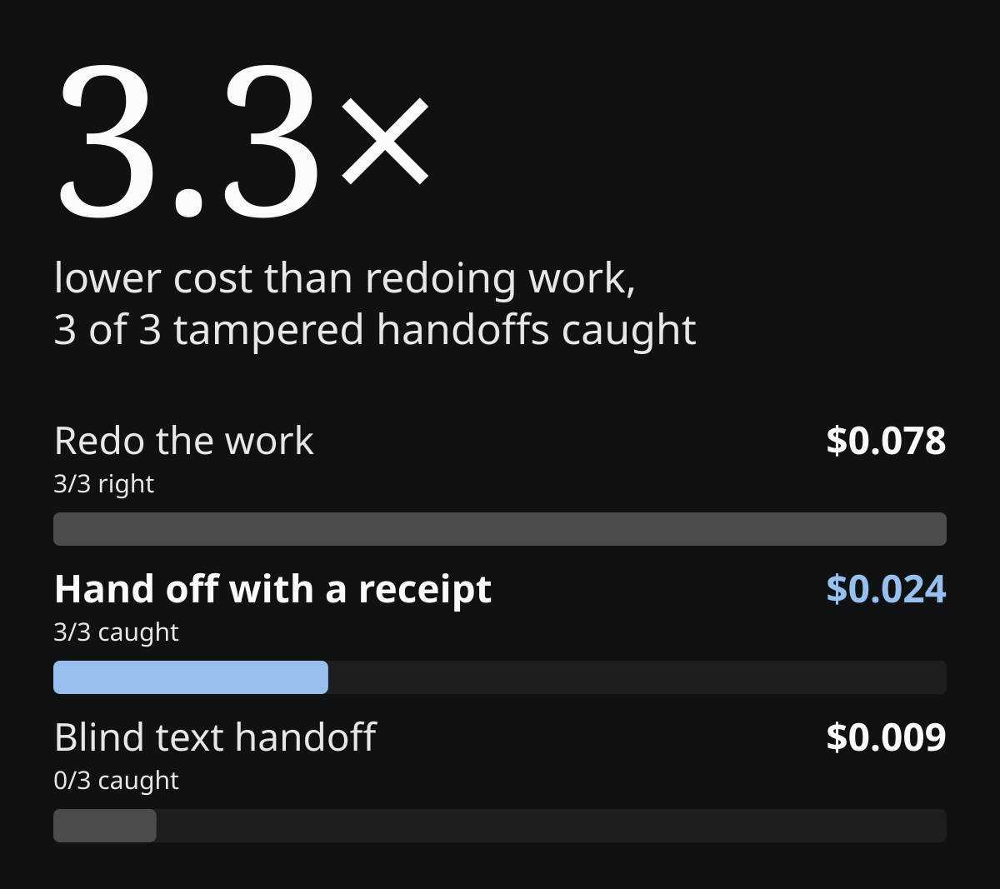

When one agent hands a finished result to another (LangGraph, CrewAI, AutoGen), the receiving agent normally either trusts the forwarded text blindly or pays to re-run the upstream work. With Proofable, the producing agent emits a 66-byte signed receipt (`qHash`) binding input, policy state and output, and the receiving agent checks it before acting.

- **3.3× cheaper than redoing the work:** **$0.024 per correct outcome** (33,240 tokens, 2 model calls per task) against **$0.078** (124,715 tokens, 3 to 5 model calls per task).
- **Trusting forwarded text is cheap and wrong:** it costs $0.009 on untouched input, but when the text was changed in transit it used the tampered value **3 of 3** times. Checking the receipt caught every change **3 of 3** times and still completed every task.
- **29× smaller handoffs:** across a 10-hop chain, passing the signed reference carried **9,900 bytes** per hop instead of **289,410 bytes** of full evidence.

### Memory that knows what is current

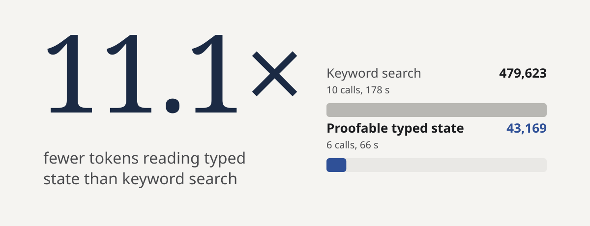
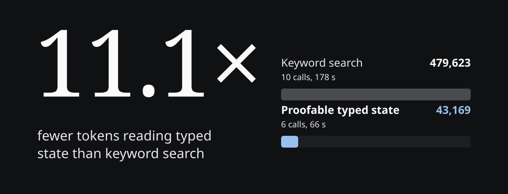
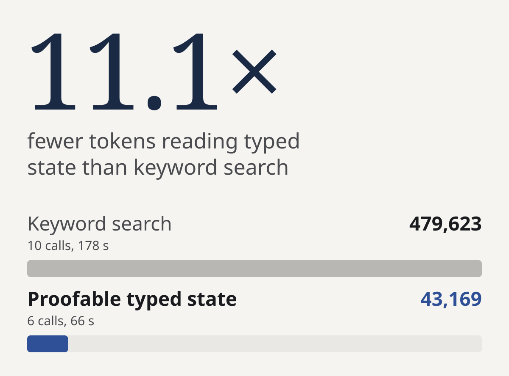
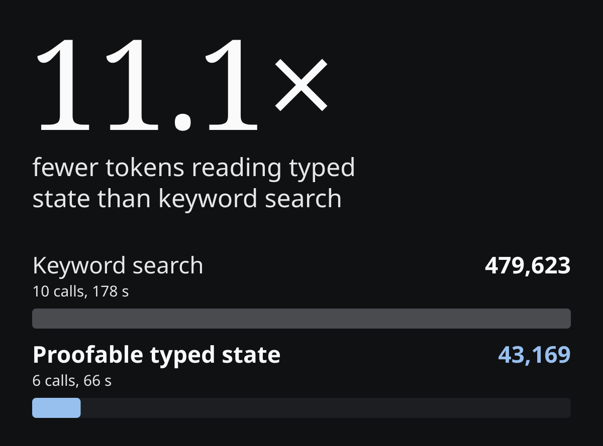

Most agent memory layers (Mem0, Zep, vector stores) return text chunks with no active or revoked status and no signer, so the agent keeps reading full bodies to work out which rule is current. Proofable stores typed, revocable, owner-signed records (`rules`, `instruction`, `receipts`), so the agent asks for active state by type and reads about 1 KB of verified metadata before opening a body.

On a 1,721-record production vault, the same questions took **105,347 tokens in 56 seconds** (7 model calls) by typed lookup against **4,462,980 tokens in 493 seconds** (55 model calls) searching record bodies by keyword: **42× fewer tokens, 8.8× faster**, and 14.6× to 18.9× lower model cost across Claude Sonnet 5.5, Gemini 3.1 Pro and GPT-6 Astra. On three direct probes, typed lookup ranked the target record first every time; keyword search pulled 61 KB to 63 KB of bodies, ranked the right plan fourth, and missed the active model-provider rule entirely.

### Research with a cost ceiling

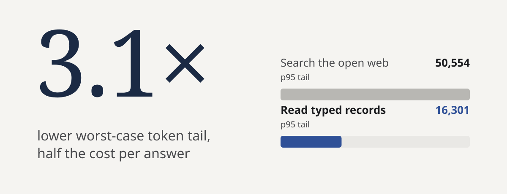
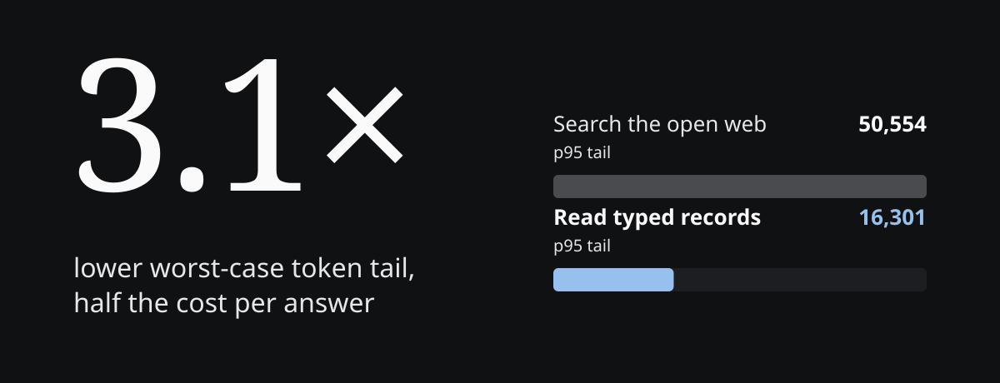
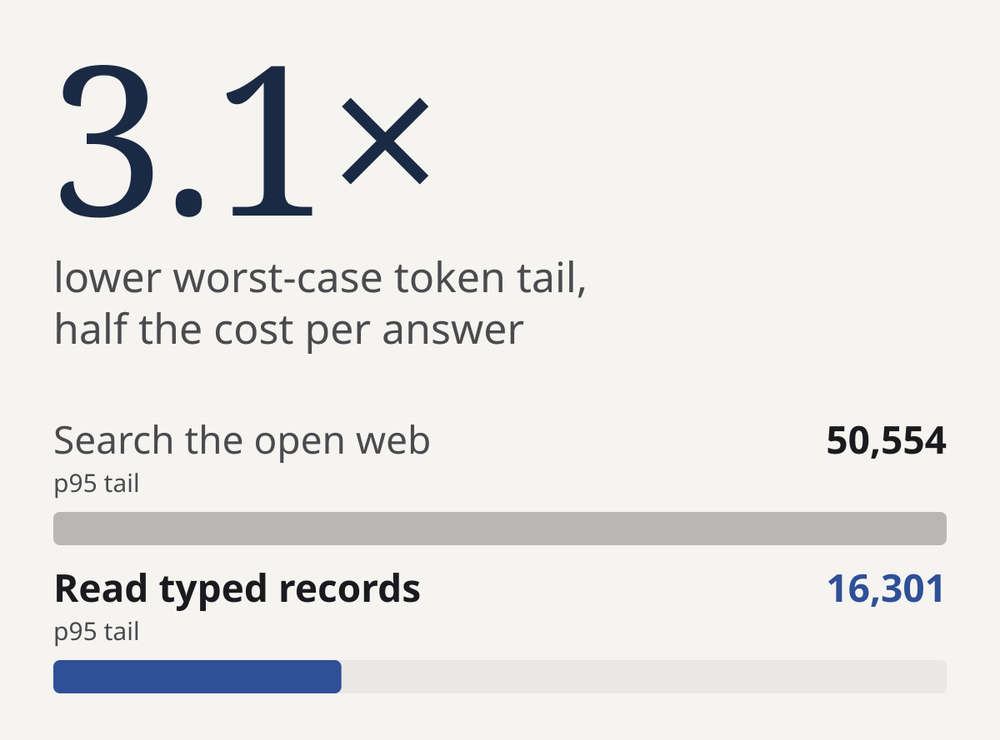
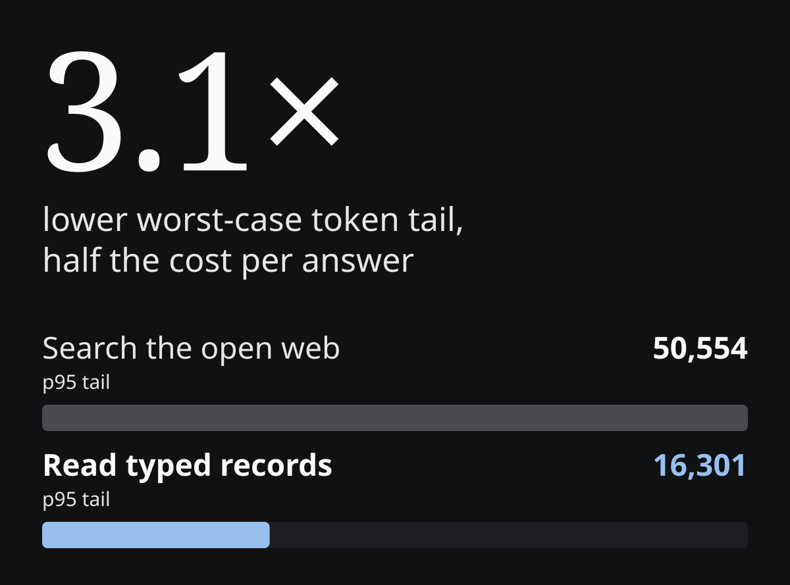

Live pages change between requests: two fetches of the same page 221 seconds apart returned 96,713 characters, then 1,129, handing two agents different evidence with no way to prove what the page said when the decision was made. On public questions about standards, agent protocols and regulation, reading signed Proofable records **halved the cost per correct answer ($0.020 vs $0.039)**, held the worst case to **16,301 tokens** where open-web search spiked to **50,554 tokens** and 104 seconds (**3.1× lower**), and cited a checkable source on **every answer** (6 of 6, against 5 of 6 on the open web).

### Identity checks paid for once

A person or business completes an interactive check once, and downstream apps and agents verify the portable proof instead of paying the vendor to run the flow again. Priced from published vendor list prices and Proofable's $0.0025 per check:

| Vendor check | 100 apps, each re-running the check | 100 apps reusing one check | Published source |
|---|---|---|---|
| Stripe Identity ($1.50 pay-as-you-go) | **$150.00** | **$1.75**, 85× lower | stripe.com/pricing |
| Sumsub Basic ($1.35 per check) | **$135.00** | **$1.60**, 84× lower | sumsub.com/pricing |
| Veriff Essential ($0.80 per check) | **$80.00** | **$1.05**, 76× lower | veriff.com/pricing |
| Footprint KYC ($0.50 per check) | **$50.00** | **$0.75**, 67× lower | onefootprint.com/pricing |

## Run it yourself

Time a reuse on your own machine, with no account and no API key:

```sh
git clone --depth 1 https://github.com/proofable/docs
cd docs/public/evidence/checks
npm install
node reuse-check.mjs
```

It reads a finished job by its id and verifies the signed receipt on your machine:

```text
Record 0xcf67dcc3cc9c203136daf9905a422601652fd76cce437e2cbf56967e3a8117e6
Signature valid offline: yes
Read by id, no account: 197 ms median over 10
Verify offline: 4.2 ms median over 10
AI tokens used: 0
```

Pass any public record id to time that record instead. To put receipts on your own agent's work, [add Proofable to your AI tool](/mcp/setup).

### Run it on every pull request

Add one workflow file and the eight permission tests run in your CI, on your account, with every record verified offline and kept as a build artifact:

```yaml
- uses: proofable/docs/public/evidence/aaif/authority-at-dispatch/action@<commit-sha>
  with:
    access-key: ${{ secrets.PROOFABLE_ACCESS_KEY }}
    operator: ${{ github.repository_owner }}
    kit-ref: <commit-sha>
```

Pin both refs to the same commit so a rerun measures the same kit. The action writes a `trustharness.report/v1` report with each case's outcome and whether each record verified offline, and fails the job when the offline check fails. [Action and report schema](https://github.com/proofable/docs/tree/main/public/evidence/aaif/authority-at-dispatch/action).

## Details for reviewers

<AccordionGroup>
  <Accordion title="Verify every record offline">
    The latest run of the permission tests produced 15 signed records. Check all of them on your machine, with no account:

    ```sh
    git clone --depth 1 https://github.com/proofable/docs
    cd docs/public/evidence/aaif/authority-at-dispatch/2026-11-02-suite
    sha256sum -c SHA256SUMS
    npm install @proofable/sdk@0.1.11
    node verify-portable-proofs.mjs
    ```

    Then, from `../reproduce/`, `node aad.mjs verify ../2026-11-02-suite` recomputes every checksum, the trace digest and all 15 envelopes offline, counts the trace rows and computes the coverage from them, and `node aad.mjs report ../2026-11-02-suite` prints the typed cost and the grading scope.
  </Accordion>

  <Accordion title="How each result was measured">
    - **Governance:** the current AgentGovBench library (commit `479c5f0`) run against the exact policy code the live service runs, matched to it by hash, beside a gate that allows everything and no governance. It measures the decision logic rather than the hosted service end to end. The agent-tool rows are the maintainers' published end-to-end runs on the earlier library (commit `e0ce93a`), where the same engine also handles 48 of 48.
    - **Permissions:** each test on the live service with a dedicated agent under its own fixed permission, and the full suite again on a production release. A revocation that lands while an action is in flight is re-checked at the executor's own boundary and refused with a typed reason.
    - **Takeover:** 84 live runs across five published attack templates and two models, with a signed record for each run.
    - **Reuse:** the median of ten runs on one finished job on the live service.
    - **Handoffs:** three public downstream tasks, one run per option, code-graded, with a separate producer and consumer agent on the same model. Dollar figures price the measured tokens at the Claude Sonnet 5.5 list rate ($2 input, $10 output per million). The 10-hop payload sizes are over the 15 published records.
    - **Memory:** the same agent and model on both options, one run each. It compares typed lookup of active state (by record scope and status before a body is fetched) with full-text keyword search over record bodies; it is not an embedding-similarity benchmark.
    - **Research:** six public questions, one run per option, same agent and model. Both options answered 6 of 6 correctly, so it measures cost ceiling, tail spread (1.3× against 6.1×) and provenance rather than accuracy.
    - **Identity:** a pricing model from published list prices, not a live run.

    Every script behind these runs is public in [`public/evidence/benchmarks`](https://github.com/proofable/docs/tree/main/public/evidence/benchmarks), pinned by commit and checksum.
  </Accordion>

  <Accordion title="Standards each result maps to">
    Each result maps to the published control it gives evidence for. None of these mappings is a certification or a compliance opinion.

    | Result | Maps to | Details |
    |---|---|---|
    | An action outside the permission, or under a revoked, expired or reused revoked permission, was stopped before it ran; the granted action ran. 5 of 5 | OWASP Top 10 for Agentic Applications 2026: ASI03 Identity and Privilege Abuse, ASI02 Tool Misuse | Agents only do what you allowed |
    | An action that needs approval was held until approved; with no answer it never ran, and a late approval was refused. 2 of 2 | EU AI Act Article 14, human oversight | Agents only do what you allowed |
    | A permission revoked mid-job: the call in flight was refused with its reason, nothing committed, and the next was refused. 1 of 1 | OWASP ASI10 Rogue Agents | Agents only do what you allowed |
    | 15 of 15 signed decision records verify offline, with no account | EU AI Act Article 12, record-keeping; NIST NCCoE Software and AI Agent Identity and Authorization project, auditing (concept paper) | Verify every record offline |
    | 150 of 150 changed copies rejected across ten kinds of forgery; 15 of 15 real records accepted; a check that only reads the format accepts all 150 | OWASP ASI07 Insecure Inter-Agent Communication | Records nobody can fake |
    | A finished result verified offline in 3.7 ms with zero AI tokens and no account; producing it took 2.79 s and 2,426 tokens | CAIP-380 Portable Proof | Reuse instead of redo |
    | AgentGovBench, current library: 48 of 48, against 46 for the maintainers' gateway, 20 for a gate that allows everything and 5 with no governance | NIST AI RMF GOVERN-1.1, 1.2, 1.4; MAP-2.1, 4.1; MEASURE-2.3, 2.6, 2.7; MANAGE-2.1, 2.2, 4.1 (the controls tagged on the scenarios) | Governance coverage |

    The frameworks: [OWASP Top 10 for Agentic Applications 2026](https://genai.owasp.org/resource/owasp-top-10-for-agentic-applications-for-2026/), the [EU AI Act](https://eur-lex.europa.eu/eli/reg/2024/1689/oj), the [NIST AI RMF](https://www.nist.gov/itl/ai-risk-management-framework), the [NIST NCCoE agent identity and authorization project](https://www.nccoe.nist.gov/projects/software-and-ai-agent-identity-and-authorization) and [CAIP-380](https://github.com/ChainAgnostic/CAIPs/blob/main/CAIPs/caip-380.md).
  </Accordion>
</AccordionGroup>
