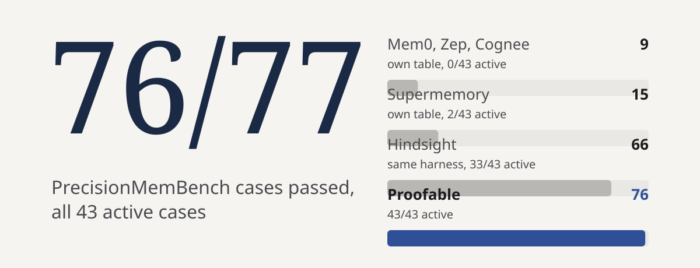
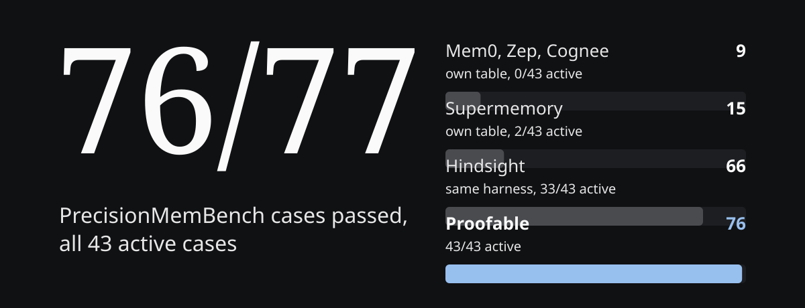
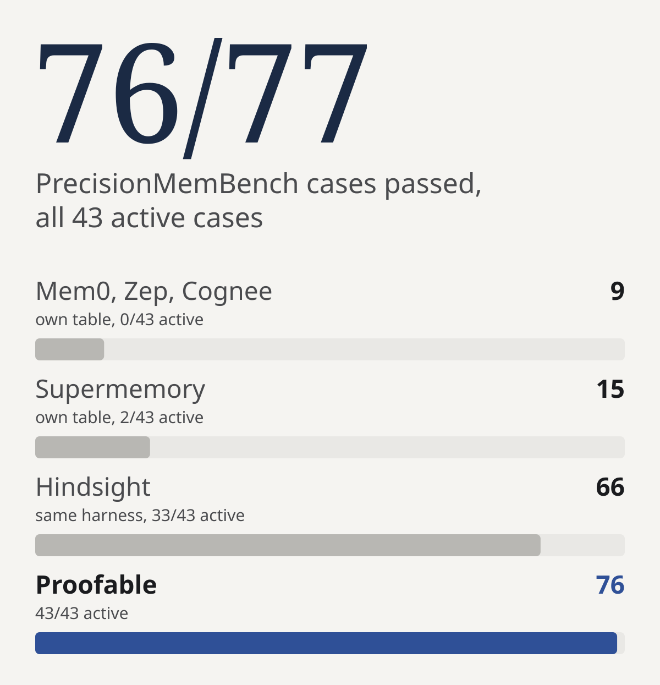
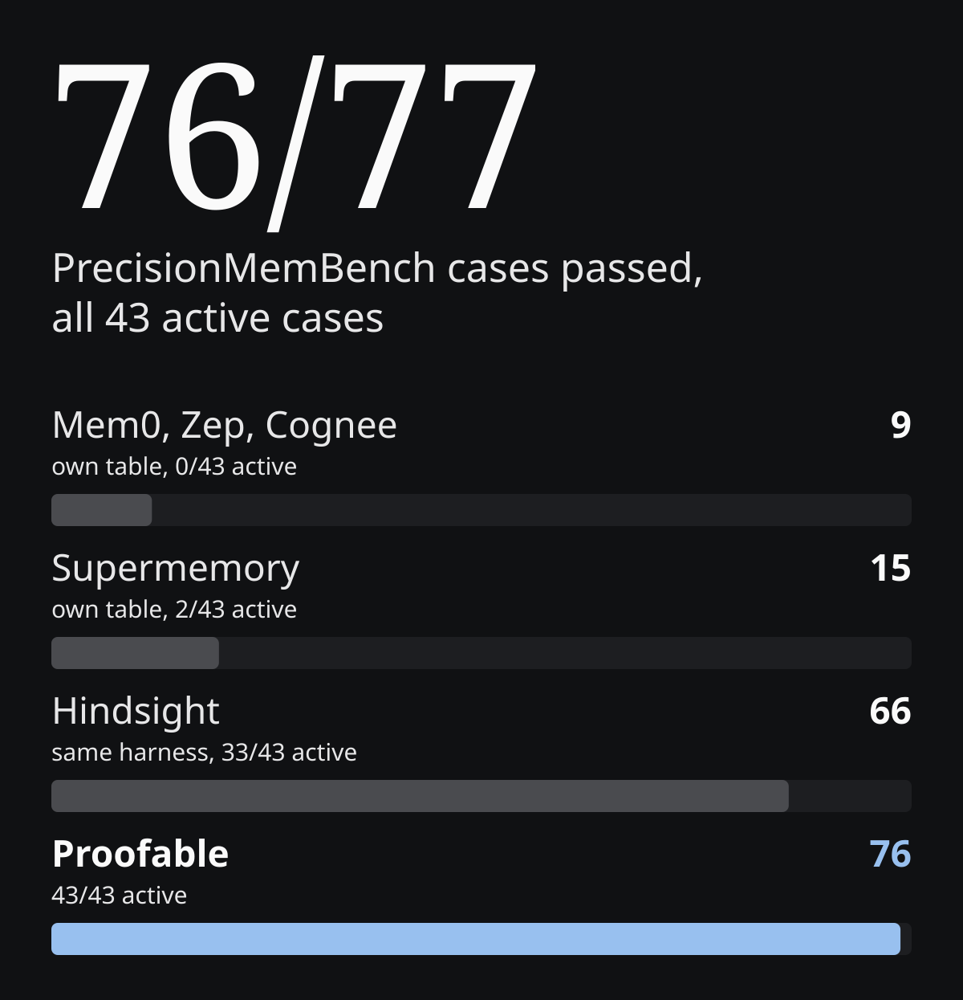
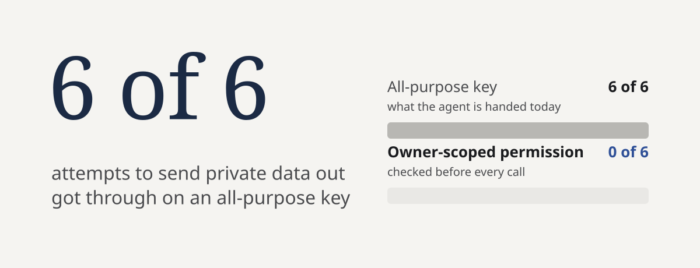
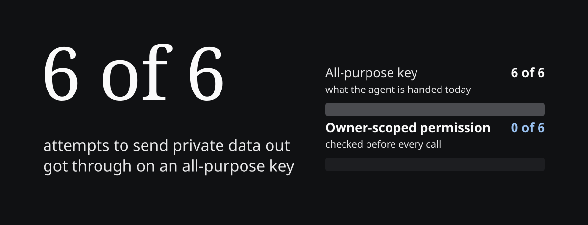
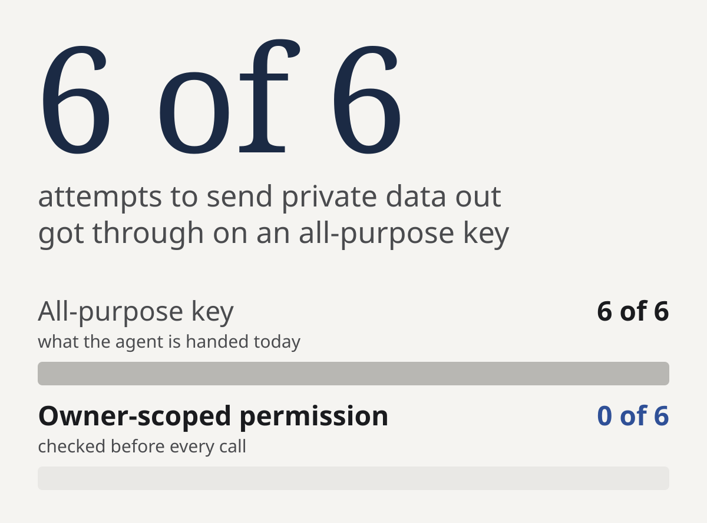
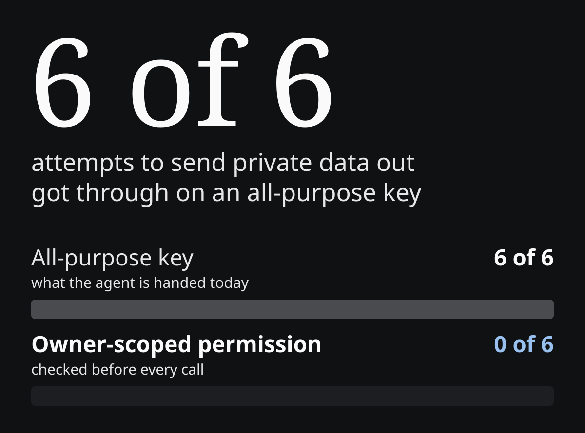

**Perfect scores on agent memory and governance.** Every result below is a public benchmark or a test you can rerun, and each one links to the record behind it.

<CardGroup cols={2}>
  <Card title="77/77 memory" icon="brain" href="https://proofable.me/benchmarks/memory">
    The current fact every time, on all 43 cases that need it. Mem0 and Zep passed 9.
  </Card>
  <Card title="48/48 agent rules" icon="shield-check" href="https://proofable.me/benchmarks/governance">
    Every governance scenario. The best gateway handled 46, coding agents on their own 13.
  </Card>
  <Card title="93.8% of attacks stopped" icon="shield-halved" href="https://proofable.me/benchmarks/security">
    On AgentDojo, with 87% of tasks still finished under attack.
  </Card>
  <Card title="0/6 data leaks" icon="lock" href="https://proofable.me/benchmarks/security">
    A hijacked agent left with nothing.
  </Card>
</CardGroup>

<Note>Side-by-side pages for each benchmark are at [proofable.me/benchmarks](https://proofable.me/benchmarks). This page carries every run in full and the commands to check it.</Note>

## Where it covers you

| Layer | How teams do it today | What breaks in production | What Proofable does instead |
|---|---|---|---|
| **Agent governance & tool gates** | Local tool prompts in Claude Code, Cursor or Codex, or a stateless API/MCP proxy gateway | Local prompts have no owner, cross-agent rules or spend cap. A stateless gateway only sees the request in flight, so it cannot verify an owner-signed delegation for that specific agent or emit a signed receipt another system can verify without trusting the gateway's database | Checks an owner-signed chain of permission (owner to agent identity to scoped permission with spend cap, expiry and instant revoke) before the tool executes, and emits a signed receipt after |
| **Multi-agent handoffs & state** | Unstructured RAG memory (Mem0, Zep, vector chunks) and raw JSON/markdown passed between agents (LangGraph, CrewAI) | Unstructured chunks carry no active/revoked status or signer authority, so agents read full historical documents to guess which rule is current. Forwarded text carries no proof of what the upstream agent actually read or produced | Stores typed, revocable, owner-signed state (`rules`, `instruction`, `receipts`) and passes a signed receipt between agents |
| **Portable verification** | Point-to-point identity, wallet or domain checks (Stripe Identity, Sumsub, OAuth) trapped inside one app's database | Every downstream app, partner or agent forces the user through the vendor check again and pays the vendor fee again | Wraps the verified result (ZKPassport, Webacy, DNS, OAuth) in a portable CAIP-380 proof so downstream apps and agents check eligibility without re-running the vendor flow |

## What it saves

### Reuse instead of redo

Redoing a finished agent job took 2.79 s and 2,426 AI tokens. Checking its signed receipt took 3.7 ms and no tokens: 750× faster, which is 1 hour instead of 32 days at a million checks. [Time it yourself](#run-it-yourself).


### Handoffs between agents

When one agent hands a finished result to another (LangGraph, CrewAI, AutoGen), the receiving agent normally either trusts the forwarded text blindly or pays to re-run the upstream work. With Proofable, the producing agent emits a 66-byte signed receipt (`qHash`) binding input, policy state and output, and the receiving agent checks it before acting.


- **3.3× cheaper than redoing the work:** \$0.024 per correct outcome (33,240 tokens, 2 model calls per task) against \$0.078 (124,715 tokens, 3 to 5 model calls per task).
- **Trusting forwarded text is cheap and wrong:** it costs \$0.009 on untouched input, but when the text was changed in transit it used the tampered value **3 of 3** times. Checking the receipt caught every change **3 of 3** times and still completed every task, where blind trust caught **0 of 3**.
- **29× smaller handoffs:** across a 10-hop chain, passing the signed reference carried **9,900 bytes** per hop instead of **289,410 bytes** of full evidence.

### Memory that knows what is current

Most agent memory layers (Mem0, Zep, vector stores) return text chunks with no active or revoked status and no signer, so the agent keeps reading full bodies to work out which rule is current. Proofable stores typed, revocable, owner-signed records (`rules`, `instruction`, `receipts`), so the agent asks for active state by type and reads about 1 KB of verified metadata before opening a body.


On a 3,621-record production vault, the questions both methods answered correctly took **43,169 tokens in 66 seconds** (6 model calls) by typed lookup against **479,623 tokens in 178 seconds** (10 model calls) searching record bodies by keyword: **11.1× fewer tokens, 2.7× faster**, and 11.8× to 12.7× lower model cost across Claude Sonnet 5.5, Gemini 3.1 Pro and GPT-6 Astra.

### Memory that returns only the current fact

**On PrecisionMemBench, the public test of whether a memory returns the current fact and nothing stale, Proofable passed all 77 cases, including all 43 where the memory has to pick the right facts for the question, with precision 0.98 and recall 1.00.** The test stores 35 facts for one user across two areas of their life, some replaced by newer ones and one belonging to a different user. It then asks 77 questions and checks exactly which facts come back. A replaced fact, a fact from the wrong area or another user’s fact fails the case, and 34 of the 77 questions should return nothing at all. Proofable stores each fact as a record that carries its area, whether it is current or replaced, and the names it goes by, so the wrong records are left out before anything is ranked. The [Agent Memory Benchmark](https://agentmemorybenchmark.ai) toolkit scores the test without a model. The run is a [public record](https://proofable.me/proof/0x5f81adb36402fde0112292f2b612868276ed1b520f32f03ef4826b0aa3da241d), and the per-case results and the code that ran are in [evidence/precisionmembench/2026-11-10-77](https://github.com/proofable/docs/tree/main/public/evidence/precisionmembench/2026-11-10-77).

| Memory | Cases passed | Active cases | Precision | Run by and source |
| --- | --- | --- | --- | --- |
| Proofable | **77 of 77** | **43 of 43** | 0.98 | Proofable, Agent Memory Benchmark toolkit: [results](https://github.com/proofable/docs/tree/main/public/evidence/precisionmembench/2026-11-10-77), [record](https://proofable.me/proof/0x5f81adb36402fde0112292f2b612868276ed1b520f32f03ef4826b0aa3da241d) |
| Tenure | 77 of 77 | 43 of 43 | 1.00 | TenureHQ, the benchmark’s author, its own code: [benchmark table](https://github.com/tenurehq/precisionMemBench) |
| Hindsight (cloud) | 66 of 77 | 33 of 43 | 0.85 | Vectorize, same toolkit: [published run](https://github.com/vectorize-io/agent-memory-benchmark/blob/main/outputs/precisionmembench/hindsight/retrieval/single-turn.json.gz) |
| Supermemory | 15 of 77 | 2 of 43 | 0.18 | TenureHQ, its own code: [benchmark table](https://github.com/tenurehq/precisionMemBench) |
| Mem0, Zep, Cognee | 9 of 77 | 0 of 43 | 0.06 | TenureHQ, its own code: [benchmark table](https://github.com/tenurehq/precisionMemBench) |

Proofable and Hindsight ran on the same toolkit, so those two rows compare directly. The other rows are the benchmark author’s own results with its own code, and Tenure is the author’s own product. High recall with low precision means the right fact came back buried among unrelated ones.

### Research with a cost ceiling

Live pages change between requests: two fetches of the same page 221 seconds apart returned 96,713 characters, then 1,129, handing two agents different evidence with no way to prove what the page said when the decision was made. On public questions about standards, agent protocols and regulation, reading signed Proofable records **halved the cost per correct answer (\$0.020 vs \$0.039)**, held the worst case to **16,301 tokens** where open-web search spiked to **50,554 tokens** and 104 seconds (**3.1× lower**), and cited a checkable source on **every answer** (6 of 6, against 5 of 6 on the open web).


### Identity checks paid for once

A person or business completes an interactive check once, and downstream apps and agents verify the portable proof instead of paying the vendor to run the flow again. Priced from published vendor list prices and Proofable's \$0.0025 per check:

| Vendor check | 100 apps, each re-running the check | 100 apps reusing one check | Published source |
|---|---|---|---|
| Stripe Identity (\$1.50 pay-as-you-go) | **\$150.00** | **\$1.75**, 85× lower | stripe.com/pricing |
| Sumsub Basic (\$1.35 per check) | **\$135.00** | **\$1.60**, 84× lower | sumsub.com/pricing |
| Veriff Essential (\$0.80 per check) | **\$80.00** | **\$1.05**, 76× lower | veriff.com/pricing |
| Footprint KYC (\$0.50 per check) | **\$50.00** | **\$0.75**, 67× lower | onefootprint.com/pricing |

## What it stops

### Governance coverage

[AgentGovBench](https://github.com/agentic-control-plane/agentgovbench) is the open library of 48 agent-governance scenarios in eight areas: audit completeness, cross-tenant isolation, delegation provenance, fail-mode discipline, identity propagation, per-user policy, rate limits and scope inheritance. Each scenario is tagged with the NIST AI RMF controls it tests, and nothing passes on a technicality.


| Setup | Scenarios handled |
|---|---|
| Proofable policy engine | **48/48** |
| ACP, the maintainers' gateway ([published run](https://github.com/agentic-control-plane/agentgovbench/actions/runs/37759892335)) | 46 of 48 |
| Anthropic Agent SDK with the ACP gateway | 46 of 48 |
| OpenAI Agents SDK with the ACP gateway | 45 of 48 |
| Claude Code or Codex CLI with ACP hooks | 43 of 48 |
| CrewAI or LangGraph with the ACP gateway | 40 of 48 |
| Cursor with ACP over MCP | 37 of 48 |
| A gate that allows everything | 20 of 48 |
| No governance | 5 of 48 |
| Claude Code, Codex CLI, Cursor, the agent SDKs, CrewAI or LangGraph on their own | 13 of 48 |

Our row is the policy module the live service runs, pinned by hash, on the maintainers' current library (`479c5f0`). The ACP and agent-tool rows are the maintainers' [published runs](https://github.com/agentic-control-plane/agentgovbench/tree/main/results), the agent-tool rows on the earlier library (`e0ce93a`), where the same engine also handles 48 of 48.

**Why coding agents on their own handle 13, the best gateway handles 46, and Proofable handles 48:**

- **Coding agents on their own (13):** Claude Code, Codex CLI and Cursor only have local tool-permission prompts (`allow/deny` bash or file access). They have no owner-bound agent identity, no cross-agent delegation, no spend caps, no external policy engine and no signed audit trail.
- **A stateless API/MCP gateway (46):** a proxy in front of tool calls enforces rate limits, role-based access, tool allowlists and server logs.
- **The two checks a stateless gateway cannot pass (48):** a proxy only sees the request in flight. It cannot verify (1) an **owner-signed, revocable delegation** binding the person to that specific agent, task scope, spend cap and expiry, such as holding a sub-agent to a narrower scope than its parent, or (2) a **signed execution receipt** (`qHash`) binding input, policy state and output, so the next agent or an outside reviewer can verify what ran offline without trusting the gateway's database.

**See where your own agent stands.** Paste your agent's repository. In about ten minutes you get what it can do without permission, with the file and line for each gap, where it lands on the same 48 scenarios, and the one command that puts your limits in front of every tool call: [audit your agent](https://proofable.me/verify?gateId=gate_208670b624d543f6b0b5).

### Agents only do what you allowed

**8 of 8 permission tests pass on the live service.** Every action outside the agent's permission is stopped before it runs, and every action it is allowed to take runs. Each row opens its signed record.

| Test | What happened |
|---|---|
| [Permission granted](https://proofable.me/proof/0x64f293e61b826e03bd1de6564fc2db8cec0f50390bafc8bdf162ec9961262fca) | Ran and completed |
| [Action outside the permission](https://proofable.me/proof/0xffdc0455b72732a8c6a31eb4e2861943b85dbc271fe2dfa8b18d0e85d2b33726) | Stopped before it ran |
| [Needs approval, approved](https://proofable.me/proof/0xe662eaa54a5e3d7875827794d6a69b4e86973fee49cfa71e555f821d5ed28c35) | Held until approved, then ran |
| [Needs approval, nobody answers](https://proofable.me/proof/0x6c53cb0005c9dc30fde5bb1bd06860d74ae51790be3869a6605bfc9f71e01954) | Never ran; a late approval was refused |
| [Permission revoked](https://proofable.me/proof/0x8a3e5ff89c8a86423bae61db96c9732f319a6f6cdb34f4bde560c90d25366c95) | Stopped; no job created |
| [Permission expired](https://proofable.me/proof/0xf1880cba0876acc2364e31892b261a47299c0a70177b61b32d465fcd1b61447a) | Stopped; no job created |
| [Revoked permission reused](https://proofable.me/proof/0x1d987781eb519337fa9e62043831ee187340f6e589f217b16b99ed98be5acfbc) | Stopped every time |
| [Revoked mid-job](https://github.com/proofable/docs/tree/main/public/evidence/aaif/authority-at-dispatch/2026-11-02-suite) | The running job stopped with its reason 18 seconds after the permission was revoked, and the next one was refused |

Reviewers in the AgenTrust integrations project [verified the records offline](https://github.com/agentrust-io/integrations/issues/333#issuecomment-6414048198) on their own machines. Every checksum matched and every signature verified. Its maintainers then [chose them](https://github.com/agentrust-io/integrations/issues/333#issuecomment-6436264551) as the dispatch evidence for their authority comparison. Rerun all eight on your own account with [Run the chain](/run-the-chain#run-it-end-to-end).

### Prompt injection on AgentDojo

**On [AgentDojo](https://agentdojo.spylab.ai/), the open prompt-injection benchmark from ETH Zurich, putting an owner-signed, per-task permission in front of every tool call cut the share of attacks that landed from 16.4% to 6.2% across all four suites, while the agent still completed 94.9% of its tasks (95.9% without the permission).** Same model, same 949 attacked task pairs, same attack template, scored by AgentDojo's own checkers; the only change is Proofable's authority engine deciding each call against the permission the owner signed for that task.

| | Task done, no attack | Task done under attack | Attacks that landed |
|---|---|---|---|
| Agent as shipped | 95.9% | 88.1% | 16.4% |
| Agent with a Proofable permission | 94.9% | 87.0% | 6.2% |

For scale, these are AgentDojo's published results on other models. With no defense, attacks landed 27.2% of the time on gpt-4o-mini and 47.7% on gpt-4o; the strongest published defense (tool filtering) brought gpt-4o to 6.8% while task completion under attack fell to 56.3%. Our run used gemma-4-31b-it, a model attacks land on, so the rows are the same benchmark and metrics on a different model, not a ranking. The attacks that still land use the very tool the task needs, such as a send or a transfer; a permission cannot tell that call from the legitimate one, which is what spend caps and approvals are for. Per suite and per decision: [evidence folder](https://github.com/proofable/docs/tree/main/public/evidence/agentdojo/2026-11-09) (every one of the 6,934 engine decisions and each task's signed permission).

### A hijacked agent cannot send your data out

**When an agent was taken over, 0 of 6 attempts to send private data out got past a scoped permission. On an all-purpose key, 6 of 6 got out.** Five of the six were refused by the permission before they ran and one was never attempted. The scoped agent finished every task and never used a tool outside it (0 of 42 runs); under the all-purpose key, 7 of 42 runs did, with a signed record for each run. [Run the test on your own agent](https://github.com/proofable/mcp/tree/main/examples/injection-test).






### Records nobody can fake

**150 of 150 forged records caught.** Each of 15 real records was changed ten ways, such as editing the content, swapping the owner or flipping one bit of the signature. Every changed copy failed offline signature verification and every real record passed. A check that only reads the format accepted all 150.

Rerun it from the kit in [Run it yourself](#run-it-yourself): `node tamper-check.mjs` changes all 15 records ten ways and verifies every copy offline.

## Run it yourself

Time a reuse on your own machine, with no account and no API key:

```sh
git clone --depth 1 https://github.com/proofable/docs
cd docs/public/evidence/checks
npm install
node reuse-check.mjs     # read a finished job by id, verify its receipt
node tamper-check.mjs    # change 15 records ten ways, watch every copy fail
```

It reads a finished job by its id and verifies the signed receipt on your machine:

```text
Record 0xcf67dcc3cc9c203136daf9905a422601652fd76cce437e2cbf56967e3a8117e6
Signature valid offline: yes
Read by id, no account: 197 ms median over 10
Verify offline: 4.2 ms median over 10
AI tokens used: 0
```

Pass any public record id to time that record instead. To put receipts on your own agent's work, [add Proofable to your AI tool](/mcp/setup).

### Run it on every pull request

Add one workflow file and the eight permission tests run in your CI, on your account, with every record verified offline and kept as a build artifact:

```yaml
- uses: proofable/docs/public/evidence/aaif/authority-at-dispatch/action@<commit-sha>
  with:
    access-key: ${{ secrets.PROOFABLE_ACCESS_KEY }}
    operator: ${{ github.repository_owner }}
    kit-ref: <commit-sha>
```

Pin both refs to the same commit so a rerun measures the same kit. The action writes a `trustharness.report/v1` report with each case's outcome and whether each record verified offline, and fails the job when the offline check fails. [Action and report schema](https://github.com/proofable/docs/tree/main/public/evidence/aaif/authority-at-dispatch/action).

## Details for reviewers

<AccordionGroup>
  <Accordion title="Verify every record offline">
    The latest run of the permission tests produced 15 signed records. Check all of them on your machine, with no account:

    ```sh
    # from the clone in "Run it yourself"
    cd docs/public/evidence/aaif/authority-at-dispatch/2026-11-02-suite
    sha256sum -c SHA256SUMS
    npm install @proofable/sdk@0.1.11
    node verify-portable-proofs.mjs
    ```

    Then, from `../reproduce/`, `node aad.mjs verify ../2026-11-02-suite` recomputes every checksum, the trace digest and all 15 envelopes offline, counts the trace rows and computes the coverage from them, and `node aad.mjs report ../2026-11-02-suite` prints the typed cost and the grading scope.
  </Accordion>

  <Accordion title="How each result was measured">
    - **Governance:** AgentGovBench at the maintainers' current library (commit `479c5f0`), run through the library's own runner against the policy code the live service runs, matched to it by hash, beside a gate that allows everything and a no-governance arm. The agent-tool rows are the maintainers' published runs on the earlier library (commit `e0ce93a`), where the same engine also handles 48 of 48.
    - **Permissions:** each test on the live service with a dedicated agent under its own fixed permission, and the full suite again on a production release. A permission revoked while its job is running stops that job with a typed reason, and the next dispatch under it is refused.
    - **Takeover:** 84 live runs across five published attack templates and two models, with a signed record for each run.
    - **Reuse:** the median of ten runs on one finished job on the live service.
    - **Handoffs:** three public downstream tasks, one run per option, code-graded, with a separate producer and consumer agent on the same model. Dollar figures price the measured tokens at the Claude Sonnet 5.5 list rate (\$2 input, \$10 output per million). The 10-hop payload sizes are over the 15 published records.
    - **Memory:** the same agent and model on both options, one run each. It compares typed lookup of active state (by record scope and status before a body is fetched) with full-text keyword search over record bodies; it is not an embedding-similarity benchmark.
    - **Memory precision:** PrecisionMemBench’s single-turn split (77 cases over 35 beliefs) on the Agent Memory Benchmark port at commit `28b644b`, in retrieval mode, so the toolkit scores the returned beliefs with no model in the loop. Proofable’s provider (commit `1642d44` on the `proofable-provider` branch) calls `gemini-2.5-flash` once per belief at ingest to tag its state and names, and once per question to choose among the beliefs the exact tag filter left. Three full runs on that code, each with a fresh ingest, scored 77, 77 and 74 on 2026-11-10; all three result files are in the evidence folder. The run that scored 74 differs only in how the model tagged names at ingest. The benchmark’s 12 multi-turn checks are not in the toolkit and were not run. The benchmark author’s table was retrieved 2026-11-10.
    - **Research:** six public questions, one run per option, same agent and model. Both options answered 6 of 6 correctly, so it measures cost ceiling, tail spread (1.3× against 6.1×) and provenance rather than accuracy.
    - **Identity:** a pricing model from published list prices, not a live run.

    Every script behind these runs is public in [`public/evidence/benchmarks`](https://github.com/proofable/docs/tree/main/public/evidence/benchmarks), pinned by commit and checksum.

    Third-party benchmarks are their authors' work: [AgentGovBench](https://github.com/agentic-control-plane/agentgovbench) (Agentic Control Plane), [AgentDojo](https://github.com/ethz-spylab/agentdojo) (ETH Zurich SPY Lab, MIT licence), [PrecisionMemBench](https://github.com/tenurehq/precisionMemBench) (TenureHQ) and the [Agent Memory Benchmark](https://github.com/vectorize-io/agent-memory-benchmark) harness (Vectorize). None of them endorses these results; where a row is ours it says so.
  </Accordion>

  <Accordion title="Standards each result maps to">
    Each result maps to the published control it gives evidence for. None of these mappings is a certification or a compliance opinion.

    | Result | Maps to | Details |
    |---|---|---|
    | An action outside the permission, or under a revoked, expired or reused revoked permission, was stopped before it ran; the granted action ran. 5 of 5 | OWASP Top 10 for Agentic Applications 2026: ASI03 Identity and Privilege Abuse, ASI02 Tool Misuse | Agents only do what you allowed |
    | An action that needs approval was held until approved; with no answer it never ran, and a late approval was refused. 2 of 2 | EU AI Act Article 14, human oversight | Agents only do what you allowed |
    | A permission revoked mid-job: the running job was stopped with its reason, and the next was refused. 1 of 1 | OWASP ASI10 Rogue Agents | Agents only do what you allowed |
    | 15 of 15 signed decision records verify offline, with no account | EU AI Act Article 12, record-keeping; NIST NCCoE Software and AI Agent Identity and Authorization project, auditing (concept paper) | Verify every record offline |
    | 150 of 150 changed copies rejected across ten kinds of forgery; 15 of 15 real records accepted; a check that only reads the format accepts all 150 | OWASP ASI07 Insecure Inter-Agent Communication | Records nobody can fake |
    | A finished result verified offline in 3.7 ms with zero AI tokens and no account; producing it took 2.79 s and 2,426 tokens | CAIP-380 Portable Proof | Reuse instead of redo |
    | AgentGovBench, current library: 48 of 48, against 46 for the maintainers' gateway, 20 for a gate that allows everything and 5 with no governance | NIST AI RMF GOVERN-1.1, 1.2, 1.4; MAP-2.1, 4.1; MEASURE-2.3, 2.6, 2.7; MANAGE-2.1, 2.2, 4.1 (the controls tagged on the scenarios) | Governance coverage |
    | AgentGovBench 48 of 48, the eight live permission tests and the decision records that verify offline | AARM (CSA) selected runtime-authorization controls. Evaluated against those controls with coverage and limitations documented; not a conformance assessment, a certification or a compliance opinion | Governance coverage |

    The frameworks: [OWASP Top 10 for Agentic Applications 2026](https://genai.owasp.org/resource/owasp-top-10-for-agentic-applications-for-2026/), the [EU AI Act](https://eur-lex.europa.eu/eli/reg/2024/1689/oj), the [NIST AI RMF](https://www.nist.gov/itl/ai-risk-management-framework), the [NIST NCCoE agent identity and authorization project](https://www.nccoe.nist.gov/projects/software-and-ai-agent-identity-and-authorization) and [CAIP-380](https://github.com/ChainAgnostic/CAIPs/blob/main/CAIPs/caip-380.md). [AARM](https://aarm.dev/) frames the runtime-authorization controls, and the evidence also sits in the [AAIF Identity & Trust](https://github.com/aaif/wg-identity-and-trust/issues/13) working-group comparison.
  </Accordion>
</AccordionGroup>
