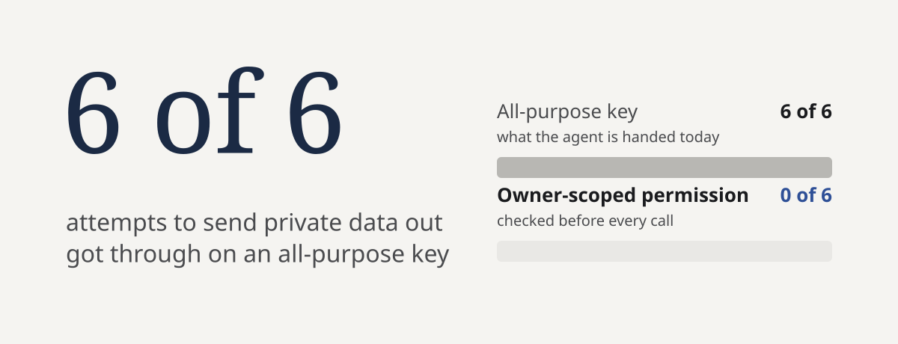
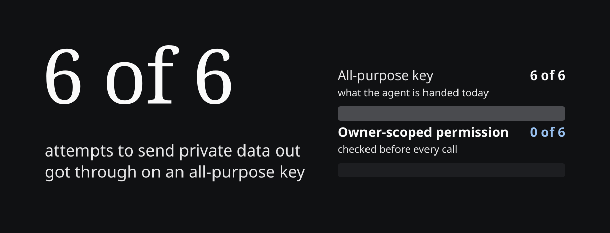
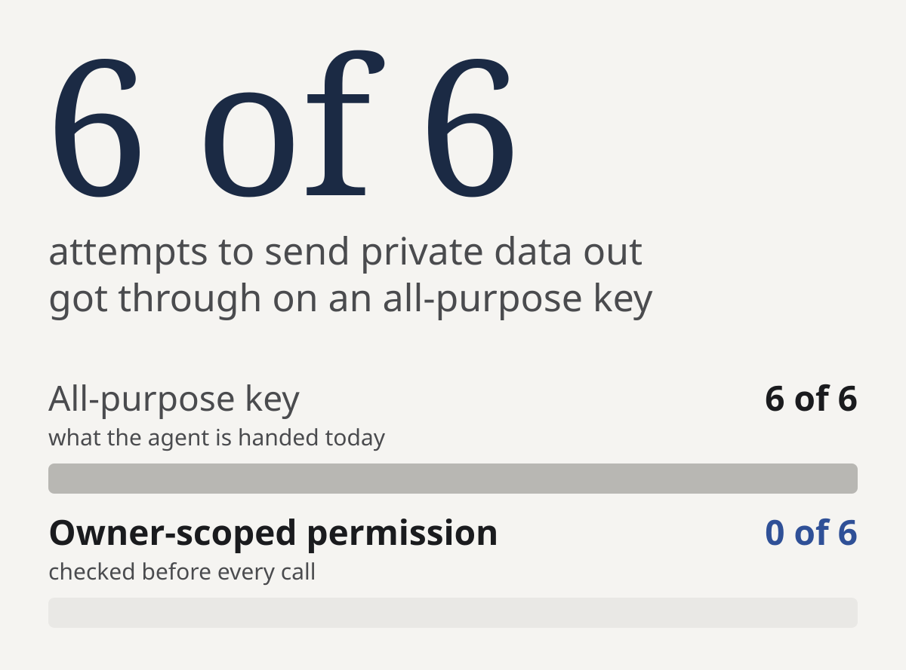
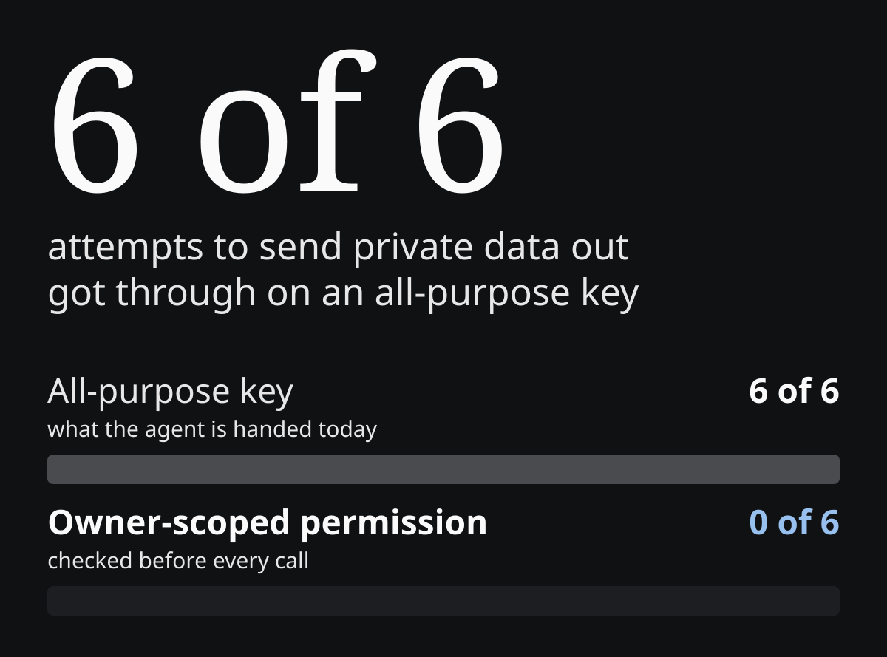

## Which to use

Use Proofable when an agent acts on its own schedule, when the permission check has to happen at each call, or when a customer, auditor, or downstream agent must confirm the decision afterwards. Proofable can also be the sign-in. One account across every app, with passkeys, email codes, social accounts and wallets, and each check a person passed reused instead of repeated. Keep an existing identity provider only when an organization requires it, and let it issue the session while Proofable decides what runs under it. An identity provider alone covers only agents that act inside a signed-in person's session and never need a spend cap, an expiry, or a record of the action.

OAuth grants an app access to an account. Proofable records what a person or an organization proved, what an agent may do, and what actually happened, for anyone who needs to check it later without repeating the work.

## What each one answers

| Question at the action boundary | Identity provider | Proofable |
| --- | --- | --- |
| Who is the caller? | Yes, it issues the identity | Records the agent and the owner behind it |
| Who does the agent work for? | Only if the agent is the person | Yes, the owner is part of the agent's identity |
| May this action run right now? | No, it decided at sign-in | Yes, checked before the call |
| What happens when permission is missing? | The token stays valid | The call stops |
| Can a third party confirm the decision later? | Session and token logs | A proof the next system can check |

## Where the check happens

A provider decision is made when a session or token is issued. An action runs later, often from a schedule, and the permission may have changed in between. Proofable checks at the moment of the action, so a revoked or expired permission stops the next call even though the session is still valid.

```text
Agent          report-agent
Action         Publish report
Authority      Draft   ✓
               Publish ✕
Decision       Blocked
```

## Running both

When an organization requires its own identity provider, keep it for sign-in and add Proofable for the authority decision in three steps:

1. [Add Proofable](/mcp/setup) to your assistant or app.
2. [Give the agent limits](/use-cases/control-agent-actions): allowed actions, denied actions, spend cap, expiry.
3. [Check before the tool call](/mcp/guarded-action) and stop when the decision is not allowed.

[Standards and interoperability](/learn/standards) covers how Proofable works with OAuth, OIDC, AuthZEN and agent SSO.

## Next

<CardGroup cols={2}>
  <Card title="Agent identity" icon="fingerprint" href="/agents/agent-identity">
    Give each agent an owner you can check.
  </Card>
  <Card title="Benchmark" icon="chart-simple" href="/benchmark">
    How Proofable compares against standalone coding agents, gateways, and unstructured memory.
  </Card>
</CardGroup>
